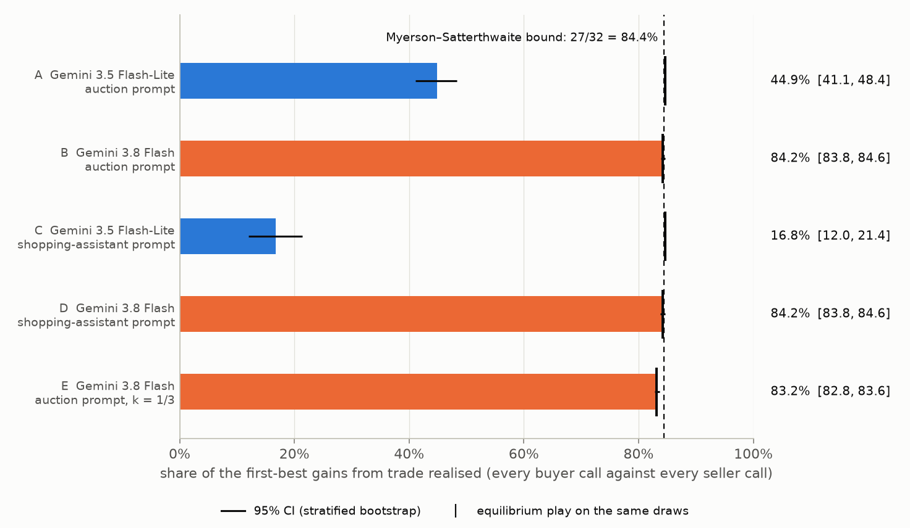
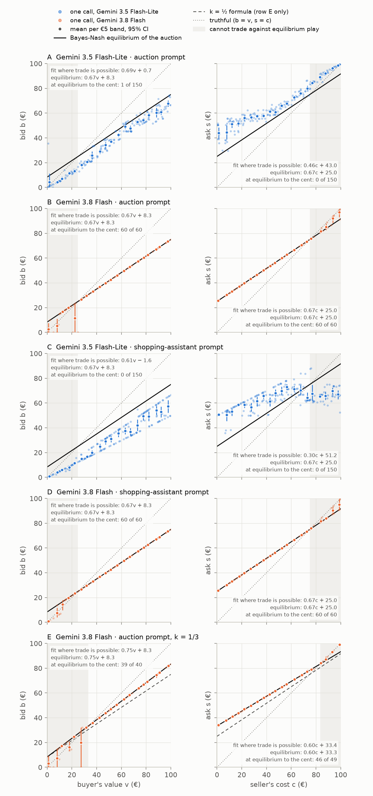
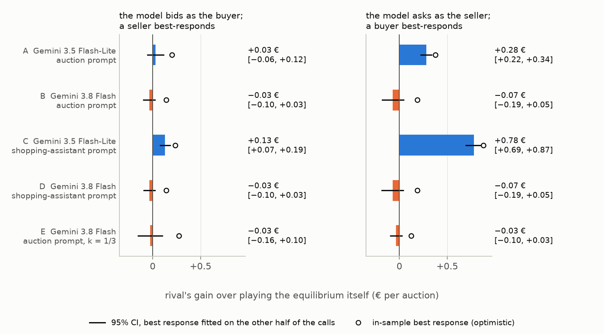

# llm-double-auction

**Can LLM agents trading on someone's behalf reach the Myerson–Satterthwaite bound?**

When a buyer and a seller each know only their own number, a 1983 theorem caps how much of
the value at stake any fair trading rule can realise. With values uniform on the same range the
cap is $27/32 = 84.4\%$. This repo puts Gemini agents on both sides of the sealed-bid double
auction that reaches the cap, and measures how much of the value they realise, how they bid,
and how easily a smarter rival could exploit them: 1,240 calls, $2.00 of API usage.



| | Model, prompt | Realised (95% CI) | Equilibrium, same draws | Trade rate | Rival's gain vs the agent as seller (€/auction) |
|---|---|---|---|---|---|
| A | Flash-Lite, auction | 44.9% [41.1, 48.4] | 84.6% | 11.6% | +0.28 [+0.22, +0.34] |
| B | Flash, auction | 84.2% [83.8, 84.6] | 84.2% | 27.9% | −0.07 [−0.19, +0.05] |
| C | Flash-Lite, shopping assistant | 16.8% [12.0, 21.4] | 84.6% | 4.4% | +0.78 [+0.69, +0.87] |
| D | Flash, shopping assistant | 84.2% [83.8, 84.6] | 84.2% | 27.9% | −0.07 [−0.19, +0.05] |
| E | Flash, auction, $k = 1/3$ | 83.2% [82.8, 83.6] | 83.2% | 27.5% | −0.03 [−0.10, +0.03] |

- **Gemini 3.8 Flash plays the equilibrium to the cent.** All 240 of 240 bids and asks that could
  trade (B and D) sat on the Chatterjee–Samuelson equilibrium within one cent, and its reasoning
  summaries named Chatterjee or Samuelson in 320 of 320 calls, including when the game was told
  as selling a used camera lens with no game-theory words. It realises the frontier.
- **It is not only recall.** With the price rule changed to $p = (b + 2s)/3$, whose equilibrium is
  not the famous one, Flash solved the new game: 85 of 89 tradeable bids and asks at the new
  equilibrium, 0 of 120 at the textbook numbers, 83.2% realised against 83.3% in theory.
- **Gemini 3.5 Flash-Lite shades far too hard** and most good deals never happen: 44.9% with the
  auction prompt. As a shopping assistant it falls to 16.8%: its asks barely follow its cost
  ($0.30c + 51.2$), and 60 of 200 asks were below its own cost where a trade could happen.
- **Exploitability tracks the same split.** A rival best-responding to Flash gains nothing over
  playing the equilibrium; against the shopping-assistant Flash-Lite seller it takes +0.78 € per
  auction, 17% more than equilibrium play.

## 1. The theorem

**Theorem (Myerson & Satterthwaite, 1983).** A seller with cost $c$ and a buyer with value $v$ may
trade one good. $c$ and $v$ are independent, each has a continuous, strictly positive density on
an interval, $[\underline c, \overline c]$ and $[\underline v, \overline v]$, and the intervals
overlap: $\underline v < \overline c$ and $\underline c < \overline v$. Both are risk-neutral and
each knows only its own number. Then no mechanism is at the same time

1. **Bayesian incentive compatible**: reporting one's number truthfully is a best response when
   the other side does (by the revelation principle this covers every Bayes–Nash equilibrium of
   every trading game);
2. **interim individually rational**: every type of buyer and seller expects a non-negative payoff
   from taking part;
3. **ex-post efficient**: trade happens if and only if $v > c$;
4. **budget balanced**: no money from outside; the buyer pays what the seller receives.

**The uniform case** (Myerson & Satterthwaite's example, attained by Chatterjee & Samuelson's
equilibrium). With $v, c \sim U[0, H]$, the largest expected gains from trade that a mechanism
satisfying 1, 2 and 4 can deliver are $9H/64$, by trading exactly when $v - c \ge H/4$; ex-post
efficiency would give $H/6$. The second-best frontier is therefore

$$\frac{9H/64}{H/6} = \frac{27}{32} = 84.375\%.$$

### Why 27/32

Incentive compatibility and the envelope theorem give, for any mechanism with trade probability
$p(v, c)$ (Myerson & Satterthwaite's Theorem 1),

$$U_B(\underline v) + U_S(\overline c) = \mathrm{E}\Big[\big(\psi(v) - \phi(c)\big)\, p(v, c)\Big],
\qquad \psi(v) = v - \frac{1 - F(v)}{f(v)},\quad \phi(c) = c + \frac{G(c)}{g(c)},$$

where $U_B(\underline v)$ and $U_S(\overline c)$ are the expected payoffs of the lowest-value buyer
and the highest-cost seller, the types for whom individual rationality binds, so the right-hand
side must be non-negative. With uniform values on $[0, H]$, $\psi(v) = 2v - H$ and
$\phi(c) = 2c$. Maximising $\mathrm{E}[(v - c)\,p]$ subject to $\mathrm{E}[(2v - 2c - H)\,p] \ge 0$
pointwise, the Lagrangian $(1 + 2\lambda)(v - c) - \lambda H$ says: trade iff the gap
$d = v - c$ is at least a threshold $t$.

The gap of two independent uniforms has the triangular density $(H - |d|)/H^2$ on $[-H, H]$.
The constraint binds where

$$\int_t^H (2d - H)\,\frac{H - d}{H^2}\,\mathrm{d}d = \frac{(H - t)^2\,(4t - H)}{6H^2} = 0
\quad\Rightarrow\quad t = \frac{H}{4},$$

and a threshold $t$ realises

$$G(t) = \int_t^H d\,\frac{H - d}{H^2}\,\mathrm{d}d = \frac{(H - t)^2\,(H + 2t)}{6H^2},$$

so $G(0) = H/6$ (16.67 € with $H = 100$), $G(H/4) = 9H/64$ (14.06 €) and

$$\frac{G(H/4)}{G(0)} = \left(\frac{3}{4}\right)^2 \cdot \frac{3}{2} = \frac{27}{32}.$$

The 15.6% that is lost lives in the deals with $0 < v - c < H/4$.

### The double auction and its linear equilibrium

Buyer and seller submit a bid $b$ and an ask $s$ at the same time. If $b \ge s$ they trade at
$p = k\,b + (1 - k)\,s$; otherwise nothing happens. The headline mechanism is $k = 1/2$, split the
difference.

*Buyer's best response.* Against a seller whose asks $s(c) = \gamma c + \delta$ are uniform on
$[\delta, \delta + \gamma H]$, a buyer bidding $b$ in that range expects

$$\pi_B(b) = \frac{1}{\gamma H}\int_\delta^b \big(v - k\,b - (1 - k)\,s\big)\,\mathrm{d}s,
\qquad \pi_B'(b) \propto (v - b) - k\,(b - \delta) = 0
\;\Rightarrow\; b^*(v) = \frac{v + k\,s_{\min}}{1 + k},$$

with $s_{\min} = \delta$, clipped to the range of asks.

*Seller's best response.* Against bids $b(v) = \alpha v + \beta$, uniform up to
$b_{\max} = \beta + \alpha H$,

$$\pi_S(s) = \frac{1}{\alpha H}\int_s^{b_{\max}} \big(k\,b + (1 - k)\,s - c\big)\,\mathrm{d}b,
\qquad \pi_S'(s) \propto (1 - k)(b_{\max} - s) - (s - c) = 0
\;\Rightarrow\; s^*(c) = \frac{c + (1 - k)\,b_{\max}}{2 - k},$$

which for $k = 1/2$ is $s^* = (2c + b_{\max})/3$. Matching slopes and intercepts gives the linear
Bayes–Nash equilibrium (Chatterjee & Samuelson, 1983):

$$b(v) = \frac{v}{1 + k} + \frac{k(1 - k)}{2(1 + k)}\,H, \qquad
s(c) = \frac{c}{2 - k} + \frac{1 - k}{2}\,H.$$

For $k = 1/2$ and $H = 100$: $b(v) = \tfrac{2}{3}v + \tfrac{25}{3}$ and $s(c) = \tfrac{2}{3}c + 25$,
so $b \ge s \iff v - c \ge 25$: exactly the frontier's trade rule, hence 27/32 and 7.03 € of
expected payoff for each side. For $k = 1/3$: $b(v) = \tfrac{3}{4}v + \tfrac{25}{3}$ and
$s(c) = \tfrac{3}{5}c + \tfrac{100}{3}$; trade no longer depends on $v - c$ alone and the
equilibrium realises 83.3% ($5/6$), with 6.17 € for the buyer and 7.72 € for the seller.

Two details matter for reading the data. The linear equilibrium bids above value when
$v < 25$ and asks below cost when $c > 75$, but those numbers can never meet an equilibrium
opponent (the lowest ask is 25, the highest bid 75), so they are payoff-irrelevant: the
analysis separates *dominated numbers that could trade* from those that cannot. And against a
*finite sample* of opponent numbers the expected payoff is piecewise linear with its maximum on
a sample value, so enumerating the sample (plus "don't trade") gives the exact empirical best
response used for exploitability.

`tests/test_theory.py` checks every closed form above against numerical integration
(`scipy.integrate`), the best responses against numerical maximisation, the equilibrium as a
mutual best response for $k = 1/2$ and $k = 1/3$, and the empirical best responses against brute
force.

## 2. Design

**Agents.** Each call is one agent for one side: the prompt states the rules, the common prior
(both numbers uniform on 0–100 €), the client's own number and the objective; it never states
the solution (`tests/test_plumbing.py` checks for leaks such as "2/3" or "equilibrium"). The reply
is structured JSON with a single number. Prompts are in
[`src/llm_double_auction/prompts.py`](src/llm_double_auction/prompts.py):

- *auction prompt* (`informed-v1`): the game in its own vocabulary;
- *shopping-assistant prompt* (`shopper-v1`): the same game as a used camera lens on a second-hand
  marketplace, with a single round of sealed offers settled at the midpoint and no game-theory
  words;
- *k = 1/3 prompt* (`informed-k13-v1`): the auction prompt with $p = (b + 2s)/3$.

| | Model | Thinking | Prompt | $k$ | Draws per €5 band | Calls |
|---|---|---|---|---|---|---|
| A | `gemini-3.5-flash-lite` | minimal | auction | 1/2 | 10 | 400 |
| B | `gemini-3.8-flash` | low | auction | 1/2 | 4 | 160 |
| C | `gemini-3.5-flash-lite` | minimal | shopping assistant | 1/2 | 10 | 400 |
| D | `gemini-3.8-flash` | low | shopping assistant | 1/2 | 4 | 160 |
| E | `gemini-3.8-flash` | low | auction | 1/3 | 3 | 120 |

"minimal" is the lowest thinking level Flash-Lite accepts (thinking cannot be switched off; it
used 0 thinking tokens on every call). Flash ran at "low" (its levels are low, medium, high).
Flash's thought summaries were requested and stored; Flash-Lite had none to give. Temperature
and other sampling parameters are the API defaults.

**Values.** $[0, 100)$ is cut into 20 bands of 5 €; replicate $r$ of band $j$ is one uniform draw
inside it, rounded to cents (stratified sampling, seed 20261022). The draws depend only on role,
band and replicate, so every condition sees the same numbers. Band midpoints would not do: on
a 20 × 20 midpoint grid 15 of 400 pairs sit exactly on the equilibrium's trade boundary
$v - c = 25$, and whether they trade moves the benchmark itself between 81.6% and 87.2%. Random
draws inside the bands estimate the continuous expectation.

**Pairing.** Bids are sealed, so any buyer call can meet any seller call: every buyer call of a
condition is paired with every seller call (200 × 200 pairs for A and C). Realised gains are
$(v - c)\,\mathbf{1}[b \ge s]$, the first best on the same pairs is $\max(v - c, 0)$, and their
ratio is the efficiency. Losses split into efficient trades missed and inefficient trades made.

**Bids.** Per role: a least-squares line where trade is possible against equilibrium play (buyers
with $v \ge 25$, sellers with $c \le 75$ for $k = 1/2$), the share of numbers within one cent of
the equilibrium, dominated numbers (bid above value, ask below cost) split into those that could
and could not trade, and how often the thought summaries name Chatterjee or Samuelson.

**Exploitability.** For the agent as buyer: a rival seller computes, for each of 400 costs on a
grid, the exact best ask against the agent's bids on one half of the calls (split by replicate
parity) and is scored on the other half; and vice versa. The number reported is the rival's
gain per auction over simply playing the equilibrium against the same calls. The in-sample best
response (a rival who saw every call) is reported alongside as an optimistic bound.

**Uncertainty.** 95% intervals from 2,000 bootstrap resamples within the 5 € bands (both sides
resampled independently for efficiency); Wilson intervals for proportions. Exploitability
intervals hold the fitted best response fixed and resample the calls it is scored on.

## 3. Results



**Flash (B, D).** Where trade is possible, the fitted line is the equilibrium itself
($0.67v + 8.3$ and $0.67c + 25.0$, intervals of zero width) and 60 of 60 buyer and 60 of 60
seller numbers per condition sit within a cent of it. Over all values the share is lower (72 of
80 bids and 71 of 80 asks in B) because, only where it cannot trade, Flash sometimes leaves the
formula: some buyers with $v < 25$ bid 0 or $\tfrac{2}{3}v$ instead of the formula's
$\tfrac{2}{3}v + 8.3$, which is above their value, and some sellers with $c > 75$ ask their cost
instead of the formula's ask below it. Following the formula there, 12 of 80 B bids were above
value, but none of Flash's dominated numbers could trade (none in any Flash condition).
Payoffs are 6.96 € and 7.03 € against the 7.03 € each of theory. The shopping-assistant
framing changes nothing that matters: same 84.2%, and the thought summaries still name
Chatterjee–Samuelson in 80 of 80 calls per role.

**Flash at $k = 1/3$ (E).** 39 of 40 tradeable bids and 46 of 49 tradeable asks hit the new
equilibrium ($0.75v + 8.3$, $0.60c + 33.3$), 0 of 120 the $k = 1/2$ numbers; payoffs 6.11 € and
7.69 € against 6.17 € and 7.72 € in theory. The summaries again name Chatterjee–Samuelson
(120 of 120), and 98 of 120 mention first-order conditions or derivatives, against 1 of 320 in
the $k = 1/2$ game: recalled there, solved here.

**Flash-Lite, auction prompt (A).** Buyers bid $0.69v + 0.7$ (slope [0.67, 0.72], intercept
[−0.9, 2.2]) instead of $0.67v + 8.3$; sellers ask $0.46c + 43.0$ (slope [0.43, 0.50], intercept
[41.1, 44.9]) instead of $0.67c + 25$. Both sides over-shade, so only 11.6% of pairs trade
(28.3% would at equilibrium on the same draws) and 55.1% of the available gains are missed,
while inefficient trades cost 0.00% of them. Each side earns about half its equilibrium payoff:
3.42 € and 4.11 €.

**Flash-Lite, shopping assistant (C).** Asks barely follow cost: $0.30c + 51.2$ where trade is
possible, $0.18c + 54.5$ over all costs. 60 of 200 asks (30.0%, Wilson [24.1, 36.7]) were below
the seller's own cost and low enough to trade. Buyers bid $0.61v - 1.6$. The trade rate falls to
4.4%, the efficiency to 16.8%, and each side earns about a fifth of its equilibrium payoff.



**Exploitability.** Against Flash a best-responding rival does no better than playing the
equilibrium (every interval contains zero). Flash-Lite's over-asking is exploitable: a rival buyer
gains +0.28 € per auction [+0.22, +0.34] against the A seller and +0.78 € [+0.69, +0.87] against
the C seller, 17% more than equilibrium play earns against the same asks. As buyers the agents
are harder to exploit (at most +0.13 €). The in-sample bounds are higher (+0.88 € for the C
seller) but are inflated by overfitting: even for exact-equilibrium agents they show +0.12 € to
+0.27 €.

## 4. Models, prices and cost

- Models: `gemini-3.5-flash-lite` (listed by the API as version `3.5-flash-lite-07-2026`) and
  `gemini-3.8-flash` (listed as version `3.0`); `results/models.json` keeps the listing. Every
  response reported `model_version` equal to the model id.
- SDK and runtime: `google-genai` 2.32.0, Python 3.12.3, numpy 2.5.4, scipy 1.18.1,
  matplotlib 3.11.2, uv 0.11.16.
- Prices, paid tier, standard text, USD per million tokens, from the Gemini API pricing page
  ("Last updated 2026-10-19 UTC"); thinking tokens bill as output:

  | Model | Input | Output |
  |---|---|---|
  | `gemini-3.5-flash-lite` | 0.30 | 2.50 |
  | `gemini-3.8-flash` | 0.75 | 3.75 (doubles with input to 1.50 / 7.50 on 2027-01-01) |

- Spend, from `usage_metadata` of every call: $2.00 for 1,240 calls. Flash-Lite cost $0.00012 a
  call (A and C: $0.05 each); Flash $0.00250 a call in B ($0.40, 599 thinking tokens a call),
  $0.00298 in D ($0.48, 729) and $0.00853 in E ($1.02, 2,202): solving the unfamiliar game took
  three to four times the thinking. The run stops itself at $3.50; it never came close.
- All 1,240 replies parsed; five calls needed a retry after a 500 or 503.

## 5. Limits

- **A famous game.** Flash names Chatterjee or Samuelson in every summary, so B and D measure
  recall as much as play. E separates recalling the $k = 1/2$ numbers from solving the game, but the
  general-$k$ formula is also in Chatterjee & Samuelson (1983); E cannot rule out recall of it.
- **Summaries, not reasoning.** "Named in its reasoning" means the thought *summary* returned by
  the API, written by the model. Some summaries misattribute ("the text gives a buyer strategy…")
  although the prompt contains none.
- **One prior, one shot.** Uniform values on a common range, risk neutrality stated in the
  prompt, sealed bids, no negotiation, no repeated play, no learning. Real agentic commerce has
  asymmetric priors, multi-round haggling and agents that adapt.
- **Self-play.** Each condition pairs a model with itself; cross-model pairs were not run.
- **Model and thinking together.** Flash-Lite at minimal thinking against Flash at low thinking:
  the comparison is of configurations, not of models alone. Default temperature; each value was
  asked once per replicate, so the spread at a fixed value is not identified separately.
- **Post-hoc conditions.** D and E were added after the 20-call pilot showed Flash reciting the
  equilibrium in both framings. The pilot calls are part of the main data (they were the first
  replicate of their cells).
- **Tier.** No call hit a rate limit even 14 at a time, which suggests the paid tier, but the tier
  is only visible in AI Studio. Prices are the paid ones.

## 6. Reproduce

```bash
uv sync                          # Python 3.12, dependencies from uv.lock
make results                     # analysis, figures and carousel from the committed cache
make check                       # ruff, pytest, number check on README and slides
```

`results/raw/calls.jsonl` holds every call (prompt version and hash, raw reply, thought summary,
usage, cost, latency), so the analysis needs no API key. To call the models again, put a key in
`.env` (see `.env.example`) and run `make pilot` and `make run`; the cache is keyed by model,
prompt version, thinking level, role, value and replicate, so cached calls are never repeated
and an interrupted run resumes. `auction check FILE` flags any number in a text that is not in
the results; the README and the slides pass it.

## 7. What broke on the way

- `uv sync` failed until the package had a README: hatchling reads it at build time.
- The first individual-rationality metric flagged the equilibrium itself, which bids above
  value for $v < 25$. Dominated numbers are now split into those that could trade and those
  that cannot.
- An early `eq_efficiency` clipped the marginal value at the cost, which silently drops trades
  with negative gains for some $k$; it now clips to $[0, H]$ only.
- The first exploitability intervals refitted the best response inside each bootstrap sample.
  Duplicated calls make that fit overfit, so the intervals were biased down and some excluded
  their own point estimates. They now hold the fitted strategy fixed.
- The values were first planned on band midpoints, until the equilibrium benchmark on that grid
  came out anywhere between 81.6% and 87.2% depending on floating-point rounding at the trade
  boundary (see Design). And the pilot turned three conditions into five (see Limits).

## References

- Myerson, R. B. and Satterthwaite, M. A. (1983). Efficient mechanisms for bilateral trading.
  *Journal of Economic Theory* 29(2), 265–281.
- Chatterjee, K. and Samuelson, W. (1983). Bargaining under incomplete information.
  *Operations Research* 31(5), 835–851.
